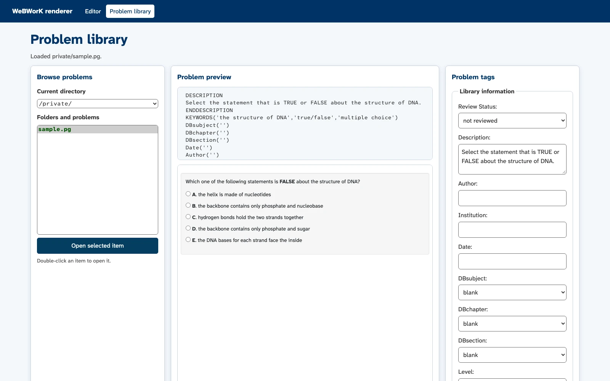
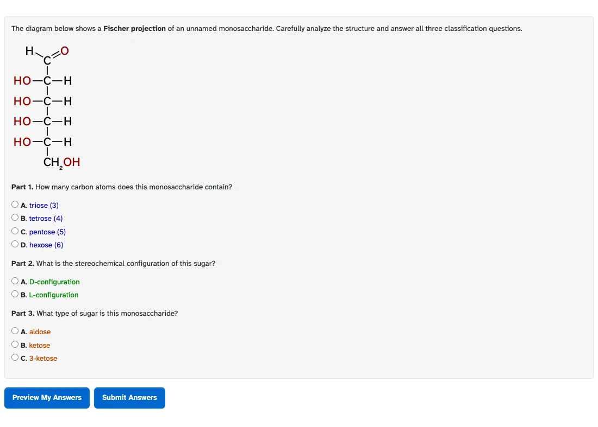
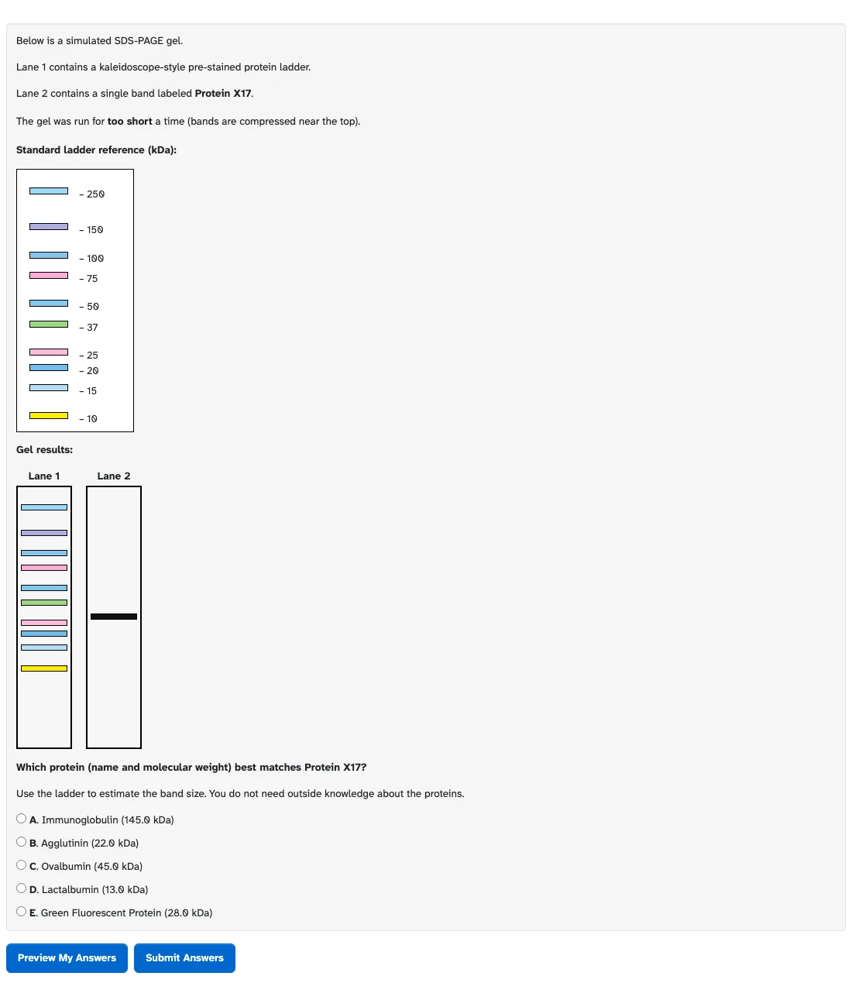
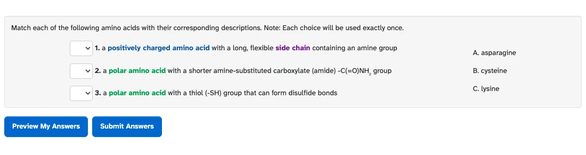
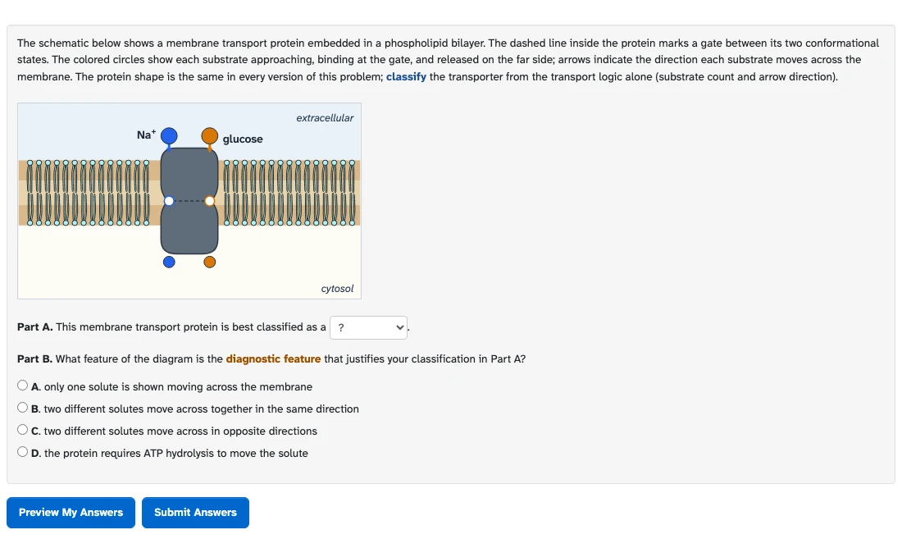
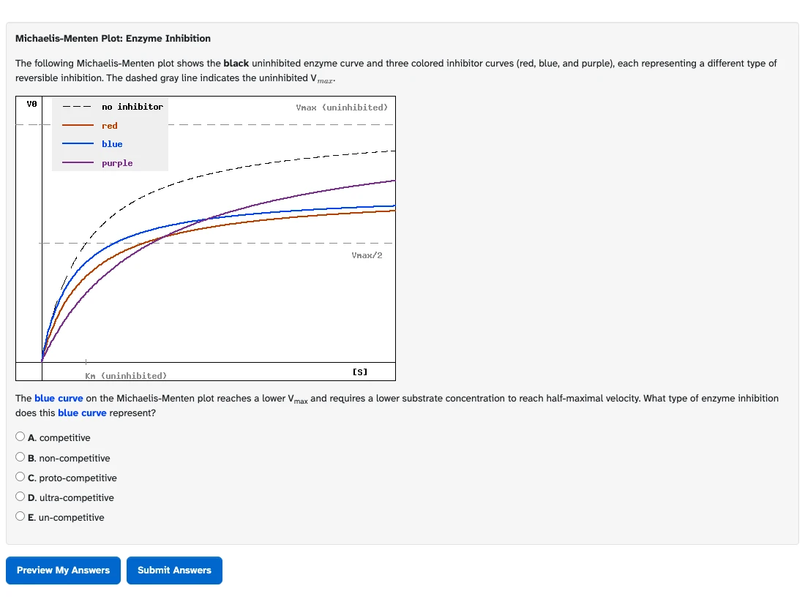
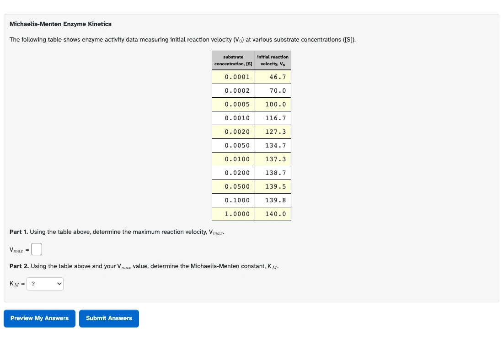

# WeBWorK PG Renderer and Editor

Edit WeBWorK PG and PGML problems beside a live preview. Instructors and problem authors can reproduce randomized variants, try student answers, and check a question before assigning it.

With the renderer running, open the [local editor](http://localhost:3000/).

## From source to student view

At seed `1234`, the bundled DNA question asks students to identify a false statement about DNA
structure. Reuse the seed to get the same prompt and choices. The editor shows the source beside
the interactive question and displays feedback after an answer is submitted. The library lets
you browse problem files, preview a selection, and edit its keywords and other metadata.

<!-- screenshots:begin (managed by screenshot-docs) -->


<!-- screenshots:end -->

## Quick start

Install Podman and `podman-compose`, and make sure the Podman engine is running. From a terminal,
clone and start this fork in development mode.

```bash
git clone https://github.com/vosslab/webwork-pg-renderer.git
cd webwork-pg-renderer
podman build -t pg-renderer .
podman-compose up -d
```

1. In the editor, enter `private/sample.pg` in **File path** and select **Load**.
2. Set **Seed** to `1234`, leave **Template** on **Default**, and select **Render problem**.
3. Choose an answer in the preview and select **Submit Answers** to see the feedback.

Run `podman-compose down` from the checkout to stop the server.

## Problem gallery

Explore six questions by Neil R. Voss from [Biology Problems](https://github.com/vosslab/biology-problems).
Select a screenshot to open it at full size.

| Structures | Experimental figures | Answer formats |
| --- | --- | --- |
| **Fischer projection**<br>[](docs/screenshots/gallery_fischer.webp) | **Protein ladder**<br>[](docs/screenshots/gallery_ladder.webp) | **Amino acid matching**<br>[](docs/screenshots/gallery_amino_matching.webp) |
| **Membrane transporter**<br>[](docs/screenshots/gallery_transporter.webp) | **Enzyme inhibition**<br>[](docs/screenshots/gallery_inhibitor.webp) | **Estimate K<sub>M</sub>**<br>[](docs/screenshots/gallery_kinetics_table.webp) |

## Test your own questions

- Put your `.pg` files in `private/`, including questions written in PGML. Load one, edit the
  source, and render again. Set a new **File path** before choosing **Save** to keep a separate copy.
- If a randomized variant needs a fix, keep its seed while you edit. Try **New seed** after the
  fix and submit answers on other variants.
- Use **Show hints** to check the hints your question provides. Choose **Static** for a copy
  suitable for handouts or **Debug** to inspect rendering diagnostics.
- In **Problem library**, open `private`, select a file, and choose **Open selected item** to
  preview it and review or edit its tags. An installed Open Problem Library appears under
  `Library` and `Contrib`.

## Render from a script

Send the same file and seed to the API to get a standalone HTML copy of the question.

```bash
curl -fsS http://localhost:3000/ \
  -H 'Content-Type: application/json' \
  -d '{"sourceFilePath":"private/sample.pg","problemSeed":1234,"outputFormat":"default"}' \
  -o /tmp/webwork-sample.html
```

Open `/tmp/webwork-sample.html` while the renderer is running to view the interactive question.
Send `Accept: application/json` for rendered HTML and structured diagnostics in the same response.
The renderer also accepts problem source directly, so scripts can pass generated PG or PGML
from a question bank.

## Documentation

- Author, debug, and test problem variants with [docs/USAGE.md](docs/USAGE.md).
- Send problems from a script and choose the output format with
  [docs/RENDERER_API_USAGE.md](docs/RENDERER_API_USAGE.md).
- Lint a single PG or PGML file from the command line with
  [script/HOW_TO_LINT.md](script/HOW_TO_LINT.md).

This fork is based on the [upstream renderer](https://github.com/openwebwork/renderer), which
uses the [WeBWorK codebase](https://github.com/openwebwork/webwork2). See
[LICENSE.GPL-3.0](LICENSE.GPL-3.0) and [docs/AUTHORS.md](docs/AUTHORS.md).
