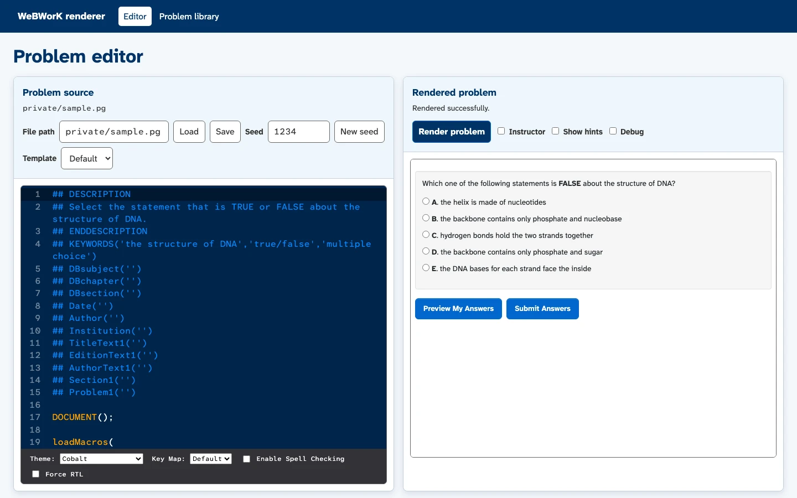
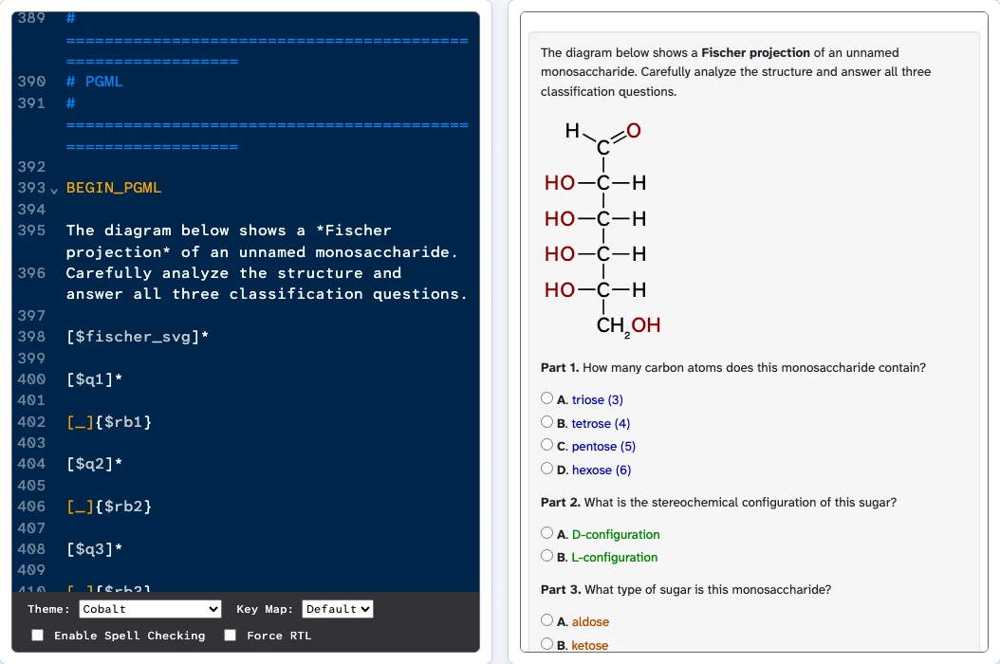
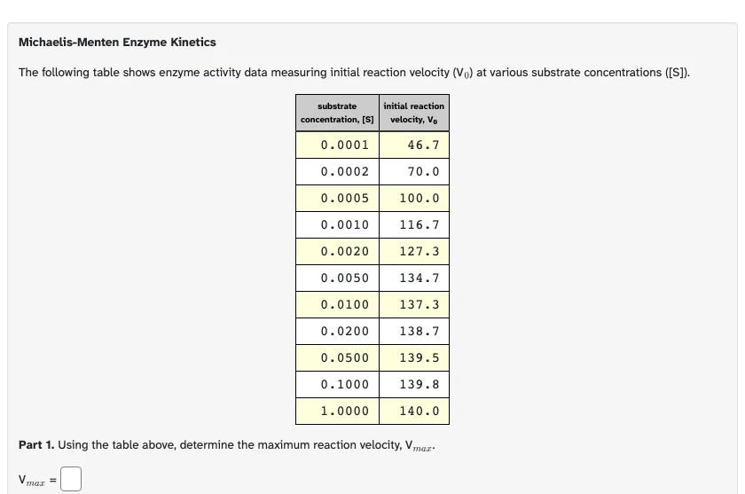
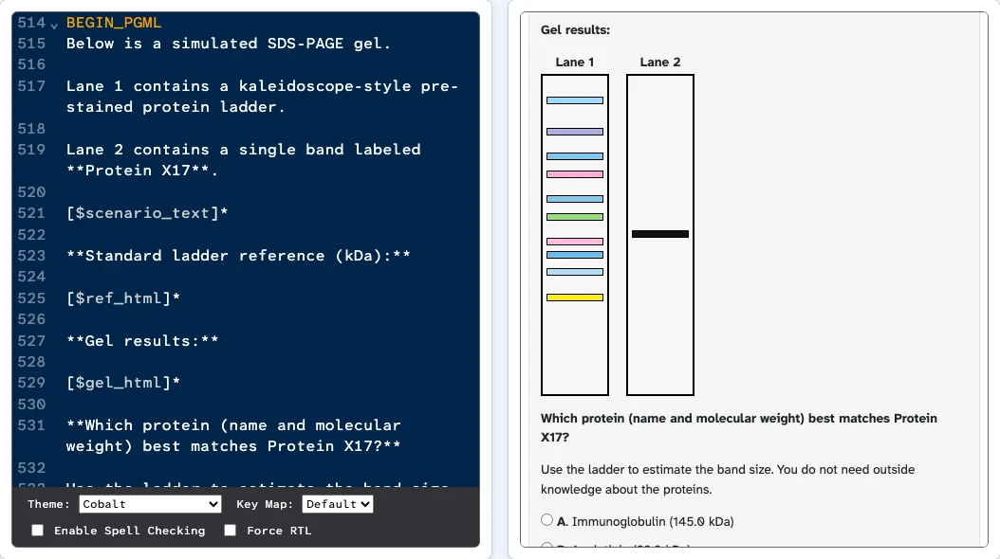
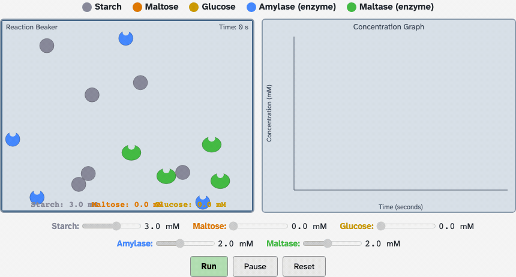
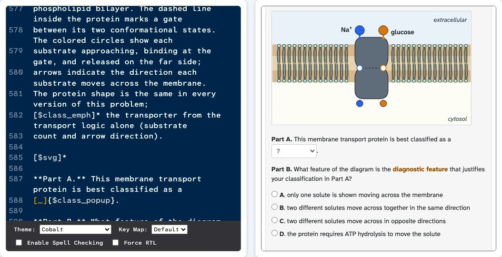
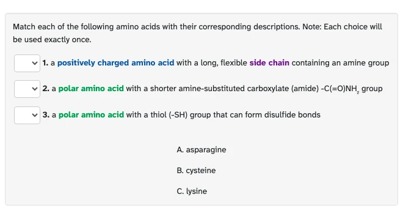

# WeBWorK PG Renderer and Editor

Write, preview, and debug WeBWorK problems in your browser. Edit PG or PGML source beside its rendered preview, and reuse a seed to reproduce a variant while you work.

With the renderer running, open the [local editor](http://localhost:3000/).

## From source to preview

At seed `1234`, the bundled DNA question renders a prompt and a fixed set of choices. Edit the
source on the left and render again to see how your changes affect the question on the right.
In the library, you can browse problem files, preview a selection, and edit its tags.

<!-- screenshots:begin (managed by screenshot-docs) -->


<!-- screenshots:end -->

## Quick start

Install Podman and `podman-compose`, and make sure the Podman engine is running. From a terminal,
clone and start this fork in development mode.

```bash
git clone https://github.com/vosslab/webwork-pg-renderer.git
cd webwork-pg-renderer
podman build -t pg-renderer .
podman-compose up -d
```

1. In the editor, enter `private/sample.pg` in **File path** and select **Load**.
2. Set **Seed** to `1234`, leave **Template** on **Default**, and select **Render problem**.
3. On the `$topic` line, change `the structure of DNA` to `DNA structure`. Select **Render
   problem** again and check that the prompt uses your new wording.

Run `podman-compose down` from the checkout to stop the server.

## Problem gallery

Explore six questions by Neil R. Voss from [Biology Problems](https://github.com/vosslab/biology-problems).
Select an image to enlarge it or replay the animation. **Full question** opens the complete
rendered output.

| Source and preview | Render details |
| --- | --- |
| **Fischer projection**<br>[](docs/screenshots/gallery_fischer_editor.webp)<br>[Full question](docs/screenshots/gallery_fischer.webp) | **Estimate K<sub>M</sub>**<br>[](docs/screenshots/gallery_kinetics_table_preview.webp)<br>[Full question](docs/screenshots/gallery_kinetics_table.webp) |
| **Protein ladder**<br>[](docs/screenshots/gallery_ladder_editor.webp)<br>[Full question](docs/screenshots/gallery_ladder.webp) | **Enzyme kinetics simulation**<br>[](docs/screenshots/gallery_enzyme_demo.gif) |
| **Membrane transporter**<br>[](docs/screenshots/gallery_transporter_editor.webp)<br>[Full question](docs/screenshots/gallery_transporter.webp) | **Amino acid matching**<br>[](docs/screenshots/gallery_amino_matching_preview.webp)<br>[Full question](docs/screenshots/gallery_amino_matching.webp) |

The enzyme animation shows starch breaking down to maltose and then glucose while the concentration
graph updates. It captures [Neil R. Voss's WeBWorK adaptation](https://github.com/vosslab/biology-problems/blob/main/problems/biochemistry-problems/enzymes/enzyme_simulation.pgml)
of [Jolene Pappas's Enzyme Simulation](https://www.biologysimulations.com/enzymes) for Biology Simulations LLC.
The animation is shared under [CC BY-NC-SA 4.0](https://creativecommons.org/licenses/by-nc-sa/4.0/).

## Write your own questions

- Put your `.pg` files in `private/`, including questions written in PGML. Load one, edit the
  source, and render again. Set a new **File path** before choosing **Save** to keep a separate copy.
- If a randomized variant needs a fix, keep its seed while you edit. Use the dice button to try
  a new seed after the fix.
- Use **Show hints** to proofread any hints you wrote, and **Debug** to inspect rendering
  diagnostics.
- In **Files**, open `private`, select a file, and choose **Open selected item** to preview it
  and review or edit its tags. With the Open Problem Library installed, the same link is labeled
  **OPL** and also shows the installed library folders.

## Render from a script

Send the same file and seed to the API to get a standalone HTML copy of the question.

```bash
curl -fsS http://localhost:3000/ \
  -H 'Content-Type: application/json' \
  -d '{"sourceFilePath":"private/sample.pg","problemSeed":1234,"outputFormat":"default"}' \
  -o /tmp/webwork-sample.html
```

Open `/tmp/webwork-sample.html` while the renderer is running to view the interactive question.
Send `Accept: application/json` for rendered HTML and structured diagnostics in the same response.
The renderer also accepts problem source directly, so scripts can pass generated PG or PGML
from a question bank.

## Documentation

- Write and debug problem variants with [docs/USAGE.md](docs/USAGE.md).
- Send problems from a script and choose the output format with
  [docs/RENDERER_API_USAGE.md](docs/RENDERER_API_USAGE.md).
- Lint a single PG or PGML file from the command line with
  [script/HOW_TO_LINT.md](script/HOW_TO_LINT.md).

This fork is based on the [upstream renderer](https://github.com/openwebwork/renderer), which
uses the [WeBWorK codebase](https://github.com/openwebwork/webwork2). See
[LICENSE.GPL-3.0](LICENSE.GPL-3.0) and [docs/AUTHORS.md](docs/AUTHORS.md).
